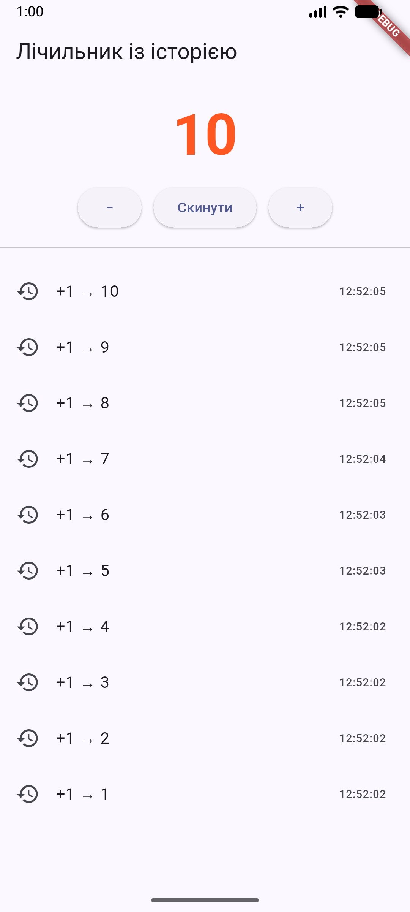
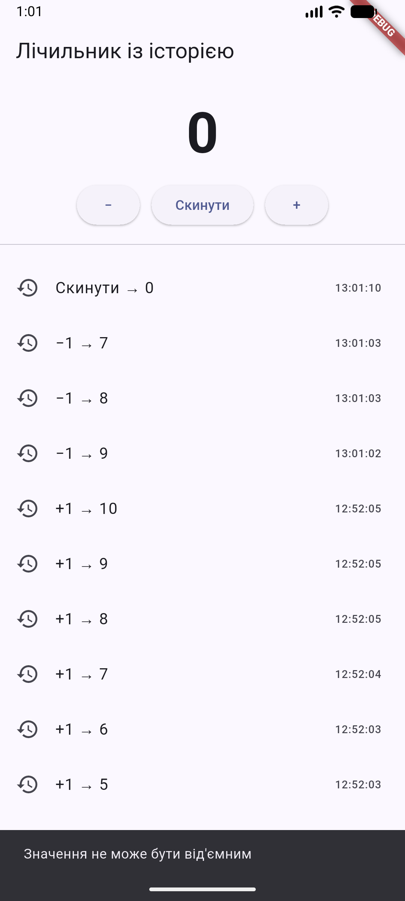
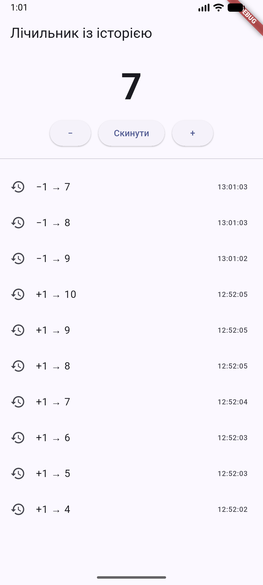
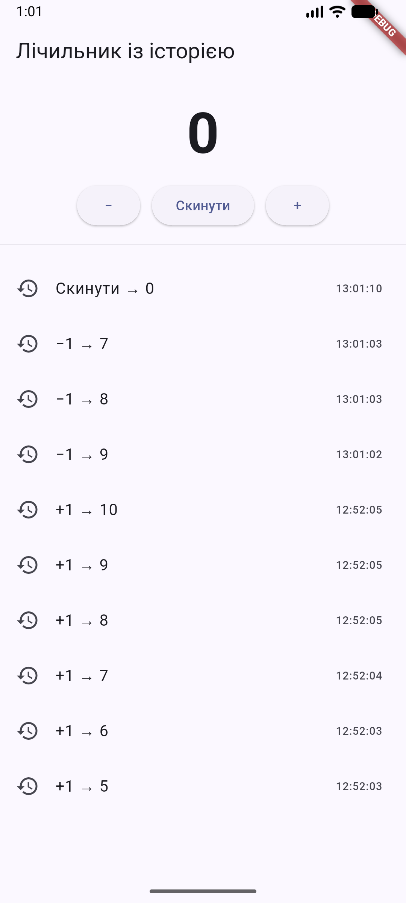
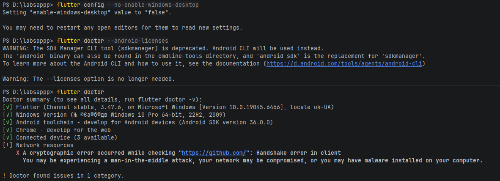

# Лічильник із історією

Практична робота 3. Варіант 3. Програмування для мобільних платформ.

## Що зроблено

- кнопки «+», «−», «Скинути»;
- історія останніх 10 дій із часом (`ListView.builder`);
- заборона від'ємних значень із повідомленням (`SnackBar`);
- число виділяється кольором, коли значення кратне 10;
- модель запису історії `HistoryEntry` в окремому файлі.

## Структура

```
lib/
├── main.dart
├── models/history_entry.dart
└── screens/counter_screen.dart
```

## Як запустити

```
flutter pub get
flutter run
```

Обрати Android-емулятор або телефон. Перевірка: `flutter analyze` → No issues found.

## Скриншоти







## Hot Reload / Hot Restart

| Зміна | Інструмент | Результат | Стан |
|---|---|---|---|
| Колір deepOrange → green | Hot Reload | спрацював | збережено |
| `_counter = 0` → `5` | Hot Reload | не підхопило | збережено старе |
| `_counter = 0` → `5` | Hot Restart | спрацювало | скинуто |

Пояснення: Hot Reload підміняє код у віртуальній машині Dart, але не
перестворює вже існуючий об'єкт `State`, тому ініціалізатор поля
`_counter = 0` повторно не виконується. Hot Restart перезапускає застосунок
і створює `State` заново.

## Труднощі та розв'язання

- Команда `flutter` не знаходилась: додав шлях до `flutter\bin` у PATH.
- Не вистачало cmdline-tools: встановив у SDK Manager.
- Збірка падала через NDK: встановив NDK у SDK Manager.
- IDE не бачила Dart SDK: вказав шлях у налаштуваннях Dart і Flutter.
- Git не встановлений: коміти робив через веб-інтерфейс GitHub.
- Файл потрапив у неправильну папку на GitHub: виправив перейменуванням.
- `flutter doctor` показує попередження Network resources (handshake з GitHub), це особливість мережі; Android toolchain зелений.
